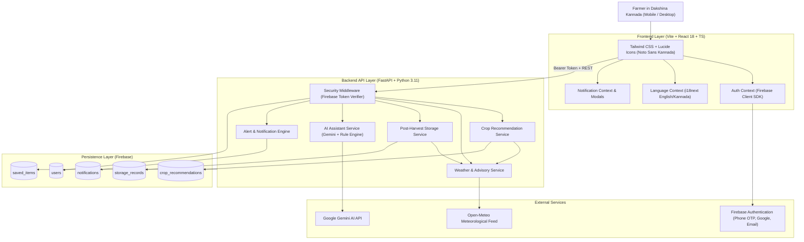
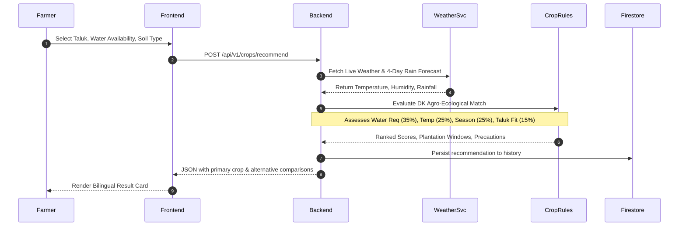
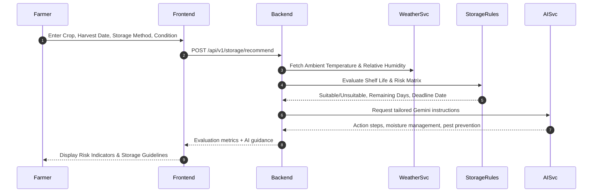

# KISSAN GUIDE — Architecture & Technical Design

## 1. Executive Summary

**KISSAN GUIDE** is an agricultural assistance web application designed specifically for the agro-ecological and climatic conditions of **Dakshina Kannada (DK), Karnataka, India**.

The platform is strictly bounded to the 4 prominent crops cultivated in the district:
1. **Coconut** (*Cocos nucifera*)
2. **Rice / Paddy** (*Oryza sativa*)
3. **Arecanut** (*Areca catechu*)
4. **Cocoa** (*Theobroma cacao*)

Across all 9 taluks: **Mangaluru**, **Bantwal**, **Belthangady**, **Puttur**, **Sullia**, **Moodbidri**, **Kadaba**, **Mulki**, and **Ullal**.

---

## 2. High-Level System Architecture

---

## 3. Core Modules & Agronomic Workflows

### 3.1 Crop Recommendation Pipeline

### 3.2 Post-Harvest Storage & AI Assistant Pipeline

### 3.3 Severe Weather Alert Pipeline
- Weather service queries Open-Meteo every 15 minutes (with in-memory cache).
- Analyzes meteorological thresholds:
  - **Thunderstorm / Lightning**: WMO Codes 95, 96, 99.
  - **Heavy Rainfall**: >64.5 mm/day or >20 mm in single hourly snapshot.
  - **High Wind**: >45 km/h coastal gusts.
  - **Excessive Heat**: >35°C in coastal humid environment.
- Formulates alert levels (**Informational**, **Moderate**, **Severe**, **Critical**).
- Dispatches in-app notifications respecting user preferences.

---

## 4. Security Architecture

1. **Token Authentication**:
   - Every protected request includes a Firebase ID token: `Authorization: Bearer <id_token>`.
   - The backend validates the cryptographically signed JWT via Firebase Admin SDK.
   - The verified Firebase UID is extracted server-side and never trusted from client-supplied request bodies.
2. **Database Isolation**:
   - Firestore security rules strictly constrain reads and updates to documents where `request.auth.uid == userId`.
3. **No Commits of Secrets**:
   - Sensitive keys are exclusively configured through environment variables (`AI_API_KEY`, `FIREBASE_CREDENTIALS_PATH`, `WEATHER_API_KEY`).
